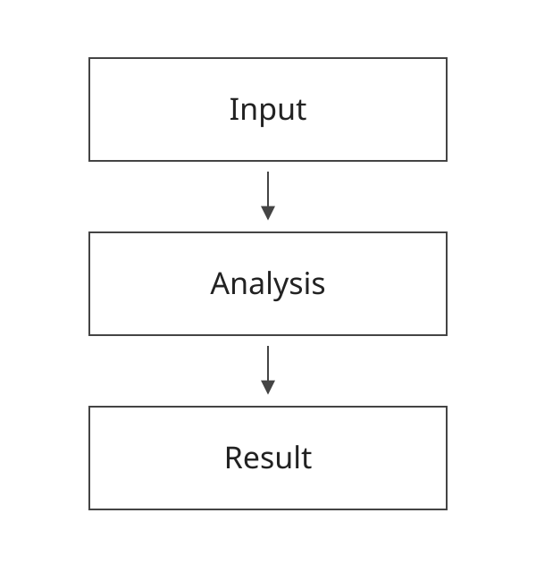

<!-- Replace the illustrative diagram and writing prompts with the report's content. Keep its figures/ directory beside this Markdown file. -->

## Method at a glance

- Name the input and scope.
- Explain the analysis step.
- State what the output represents.

<small>Conceptual schematic. Replace with your method and source.</small>

---

## Regularization adds a penalty

The objective combines data fit with a penalty on parameter magnitude.

$$
\mathcal{L}(\theta) = \mathcal{L}_{\mathrm{data}}(\theta)
+ \textcolor{#a84e00}{\lambda \lVert\theta\rVert_2^2}
$$

- $\theta$: model parameters.
- The penalty term discourages large weights; $\lambda$ sets its strength.

<small>Illustrative mathematical example. Replace with a relevant relationship.</small>
